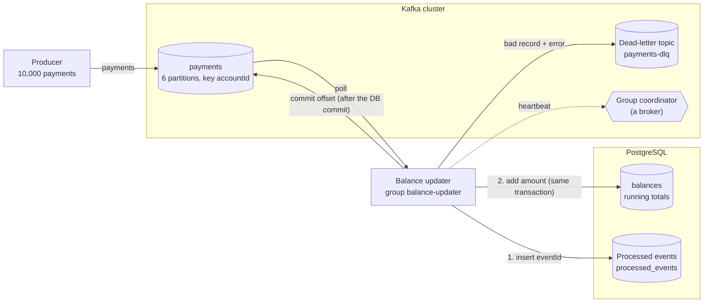

# Architecture: the idempotent balance consumer

Component names match the lesson's diagram ("The idempotent balance consumer you build"): **Producer**, **payments**, **Dead-letter topic**, **Group coordinator**, **Balance updater** (group `balance-updater`), **balances** and **Processed events**, inside a **Kafka cluster** and **PostgreSQL**.

## Components and what each owns

| Component | Where it lives | What it owns |
| --- | --- | --- |
| **Producer** | use case [`application/produce_payments.py`](src/idempotent_consumer/application/produce_payments.py), program [`interfaces/produce_cli.py`](src/idempotent_consumer/interfaces/produce_cli.py), adapter [`infrastructure/kafka_producers.py`](src/idempotent_consumer/infrastructure/kafka_producers.py), payments from [`domain/payments.py`](src/idempotent_consumer/domain/payments.py) | Builds 10,000 payments over 50 accounts, sends them keyed by `accountId`, and writes `expected_totals.json`, the answer computed from the events alone. Can also publish malformed events. |
| **payments** (topic) | created by `make up` | Six partitions, replication factor 1. The input log. Same account, same partition. |
| **Balance updater** | use case [`application/consume_payments.py`](src/idempotent_consumer/application/consume_payments.py), adapters [`infrastructure/kafka_consumer.py`](src/idempotent_consumer/infrastructure/kafka_consumer.py) and [`infrastructure/postgres_ledger.py`](src/idempotent_consumer/infrastructure/postgres_ledger.py), program [`interfaces/consume_cli.py`](src/idempotent_consumer/interfaces/consume_cli.py) | Polls, validates, applies each payment in one database transaction, then commits the offset. Owns the idempotence guard, the dead-letter decision, and the offset commit after the database commit. |
| **balances** (table) | [`sql/001_schema.sql`](sql/001_schema.sql) | One row per account, `total numeric(14,2)`. The state the consumer keeps correct. |
| **Processed events** (table `processed_events`) | [`sql/migrations/001_processed_events.sql`](sql/migrations/001_processed_events.sql) | One row per event id already applied; the primary key is the guard. Added by the step-3 migration. |
| **Dead-letter topic** (`payments-dlq`) | created by `make up` | One partition, 30-day retention. Holds each unprocessable record with its origin and error. |
| **Group coordinator** | a broker | Heartbeats, rebalances, committed offsets, and the eviction decision when `max.poll.interval.ms` passes. |
| **Checker** | use case [`application/check_balances.py`](src/idempotent_consumer/application/check_balances.py), program [`interfaces/check_cli.py`](src/idempotent_consumer/interfaces/check_cli.py) | Compares `balances` with `expected_totals.json`; prints `MISMATCH` lines with the difference. |
| **Crash harness** | use case [`application/crash_test.py`](src/idempotent_consumer/application/crash_test.py), kill points in [`domain/crash_plan.py`](src/idempotent_consumer/domain/crash_plan.py), program [`interfaces/crash_test_cli.py`](src/idempotent_consumer/interfaces/crash_test_cli.py) | Step 3's 20 crash-and-restart runs. |

The event: `{"eventId": "<uuid>", "accountId": "acct-012", "amount": 120.5}`.

## Pattern: ports and adapters

The consume loop (apply, commit after, dead-letter poison, survive an eviction) sits in `application` and knows nothing about Kafka or PostgreSQL: it asks for a `PaymentSource`, an `OffsetCommitter`, a `BalanceLedger` and a `DeadLetterSink`. The adapters in `infrastructure` implement them with `kafka-python` and `psycopg`; the programs in `interfaces` wire them together. `NaiveLedger` and `IdempotentLedger` are two implementations of one port, so the lesson's bug and its fix sit side by side. The kill switch is a function handed to the use case, the clock and sleeping are injected, and a rejected commit is a named error (`CommitRejectedError`), so the crash and eviction paths are unit-tested with fakes. Why, and what was rejected: [ADR 0002](docs/adr/0002-ports-and-adapters.md); the idempotence design: [ADR 0001](docs/adr/0001-record-the-event-id-in-the-same-transaction.md). The dependency rule is enforced by import-linter in `make lint`.

## Data flow

### One run, step by step (`make run`)

1. `make data` recreates both topics, zeroes the balances (`sql/reset.sql`) and runs the **Producer**: 10,000 payments, each with a fresh `eventId`, keyed by `accountId`. `expected_totals.json` is written from the same events, in cents-exact `Decimal` arithmetic.
2. `make migrate` applies `sql/migrations/001_processed_events.sql`, creating **Processed events**.
3. The **Balance updater** joins group `balance-updater`. The **Group coordinator** assigns it all six partitions. It polls up to 500 records.
4. For each record it parses the JSON and validates it (`parse_payment`). A bad record goes to step 7.
5. It opens one database transaction and runs two statements: `INSERT INTO processed_events ... ON CONFLICT (event_id) DO NOTHING`, and, only when that inserted a row, `UPDATE balances SET total = total + amount`. The transaction commits. A repeated event inserts nothing, so the update is skipped and the event counts as `duplicate`.
6. Only now does it commit the offset (`record.offset + 1`) to the **Group coordinator**.
7. A bad record (not JSON, no valid `eventId`, amount not a positive number with at most two decimals, unknown account) is wrapped with its topic, partition, offset, error and raw bytes, sent to the **Dead-letter topic**, acknowledged, and only then is its offset committed. The loop continues.
8. After five idle seconds the consumer closes and prints `done: {'applied': 10000, 'duplicate': 0, 'dead-lettered': 0, 'evictions': 0}`. `check_balances` compares the table with `expected_totals.json`: `all 50 balances match expected totals exactly`.

## Decisions and trade-offs

**Where the guard lives: the same transaction as the effect.** Kafka delivers at least once, and "database commit, then offset commit" has a gap. Closing the gap with a smaller gap does not work; recording the event id inside the transaction that applies the amount makes the redelivery harmless whatever the timing. The primary key on `event_id` is the arbiter, not application code that checks and then writes.

**Offsets commit after the database commit, never before.** Commit first and a crash loses the payment (at most once); commit after and a crash repeats it, which the guard absorbs (at least once plus idempotence, exactly-once in effect). Per record by default (`--commit-every 1`, the lesson's shape). The crash harness uses `--commit-every 50`, so a crash redelivers up to 50 already-applied events and the test is about the guard, not about luck.

**`eventId` as a uuid primary key.** It is the producer's identity for the event, not the Kafka offset: the offset changes if the event is republished (for example from the dead-letter topic after a fix), the id does not.

**`numeric(14,2)`, `Decimal`, never float.** Floats cannot add 0.1 and 0.2 to 0.3. The producer's JSON carries two-decimal numbers, the consumer parses them with `Decimal(str(value))`, and amounts with more than two decimals are poison, not rounded.

**Key `accountId`, six partitions.** One account's payments go through one consumer in order, so two consumers never update the same row at the same time. Balance totals do not depend on order, so this is about lock contention and replay clarity more than correctness. Six partitions cap the group at six consumers.

**Poison versus transient errors.** Only errors that can never succeed are dead-lettered (`PoisonMessage`). A database outage raises, the process exits, and the restart redelivers; dead-lettering on a transient error would park good data.

**Dead-letter topic: one partition, 30 days, an envelope with the raw bytes.** Volume is low by design, so one partition keeps the order. 30 days is long enough to investigate and replay. The envelope holds `raw` (readable) and `rawBase64` (exact bytes, so replay is byte-faithful even for invalid UTF-8).

**Eviction settings.** `max.poll.interval.ms` bounds the time between polls; `max.poll.records` times the time per record has to fit inside it. The demo lowers the interval to 10 seconds so the eviction shows in seconds; the client default is 5 minutes.

**One PostgreSQL connection, autocommit on, `with connection.transaction()`** as the only transaction boundary: no half-open transaction from an earlier statement.

**Operability.** Structured `logfmt` log lines on standard error, results on standard output; the database password is read from the environment, is a required variable with no default, and is excluded from the settings object's printed form. `SIGINT` and `SIGTERM` stop the poll loop between records, so the consumer closes its connections and leaves the group; the kill switch deliberately skips all of that (`os._exit`), because a crash does. Database connections have a connect timeout and retry with exponential backoff and jitter; Kafka clients get explicit request timeouts and retry backoff. `make health` is the health command; the image's `HEALTHCHECK` runs it.

## Failure modes the lesson teaches, and how to reproduce each

| Failure | What you see | Reproduce |
| --- | --- | --- |
| **Naive consumer, no failures** (baseline) | `all 50 balances match expected totals exactly` | `make demo-baseline` |
| **Crash between the database commit and the offset commit** | After restart one account is high by exactly one payment: `MISMATCH acct-047: expected 55191.64, got 55651.41 (off by +459.77)` | `make demo-crash` (kill switch at record 4731, `KILL_AT=...` to change) |
| **The same crash, idempotent** | Restart logs `'duplicate': N`, balances match | `make crash-test` (20 runs, each crashes at a different record, restarts, checks) |
| **Poison message** | `dead-lettered payments[1]@1126: could not convert amount to a number: 'not-a-number'`; `payments-dlq` holds the record; lag 0 on every partition | `make demo-poison` |
| **Eviction by slow polling** | `Consumer poll timeout has expired` and `EVICTED: offset commit failed (CommitFailedError)`, repeating; none with `--max-poll-records 50` | `make demo-evict` |
| **A rebalance** | Each eviction and each join or leave moves partitions; uncommitted records are redelivered | `make demo-evict` shows it as repeated evictions and rejoins |

The step-6 runbook entry is [RUNBOOK.md](RUNBOOK.md).

## Limits of the teaching build against production

- **`processed_events` grows forever.** Production prunes it (rows older than the topic's retention can never be redelivered) or partitions it by time.
- **One transaction and one offset commit per record** costs round trips; production batches the database writes and commits offsets per batch (the idempotence guard makes that safe).
- **Exactly-once in effect only where the guard is transactional.** An email or a call to another service made by the consumer is still at least once.
- **One consumer, one connection.** Production runs a group of consumers with a pooled connection each, and watches lock waits on hot accounts.
- **No metrics, no alerts.** The signals in the runbook come from logs and `kafka-consumer-groups.sh`; production exports lag, dead-letter count and duplicate count.
- **No replay tool.** A fixed event has to be republished by hand (see "How to extend it").
- **Single broker, replication factor 1, plain-text listeners, a throwaway database password.** None of this is production configuration.
- **The unknown-account rule** dead-letters payments for accounts that do not exist yet; production usually creates the account or waits for it.

## How to extend it

- **Offsets in the database** (the lesson's first stretch): store `(topic, partition, next_offset)` in a table updated in the same transaction as the balance, seek to it on assignment, and drop `processed_events`. Compare: one row per partition instead of one per event, but the consumer owns partition assignment and must handle rebalances itself.
- **A replay tool** (second stretch): read `payments-dlq`, apply a fix to `raw`, and publish the result to `payments` with the same key. The guard handles any event that was in fact applied.
- **The new group protocol** (third stretch, `group.protocol=consumer`): needs a client that supports it; the pinned `kafka-python` 3.0.12 speaks the classic protocol, so this is not built here.
- **Batch the writes:** collect a poll's records, apply them with one `executemany` inside one transaction (inserting event ids first and updating only the new ones), then commit one offset per partition. This is the other fix for eviction.
- **More event types:** add a type field, route in `process()`, and keep one guard table keyed by event id.
